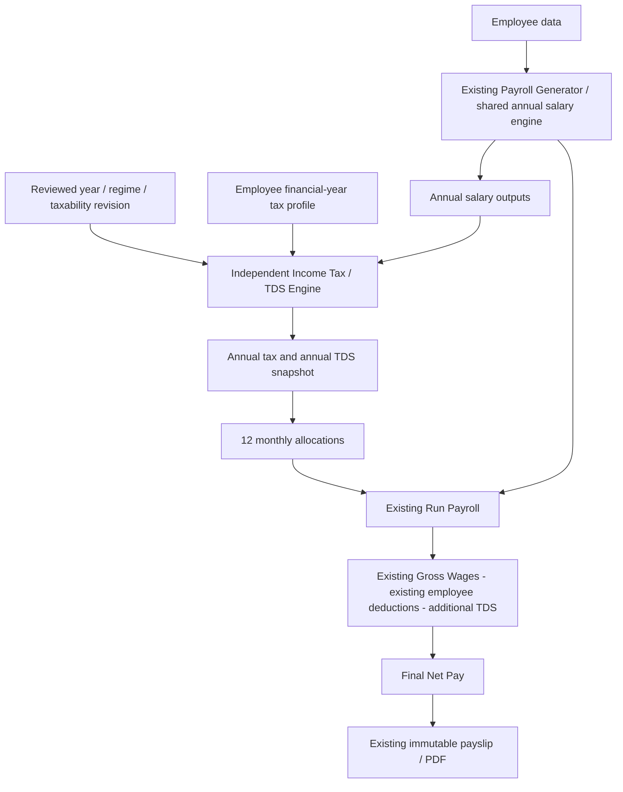

# Independent Indian Income Tax / TDS Engine

Implementation date: 31 October 2026. The attached implementation request is the authoritative Version 1.0 specification, as confirmed by the user. The earlier research document remains an investigation record; its proposed payment-confirmation and catch-up workflow is not implemented by this release.

## Delivered behavior and activation

The feature consumes `SalaryCalculationService.calculateAnnual`. It never recalculates CTC, Gross Wages, Basic, DA, RA, salary formulas, employer contributions, or existing employee deductions. All original salary/statutory engine files are unchanged.

For each new check, Run Payroll first produces its established monthly result. `applyPayrollTax` then adds precisely one employee-side component named **Income Tax / TDS**, adds its amount to existing deductions, and subtracts it from the existing Net Pay. It preserves the annual calculation object. It does not recompute Net from Gross, avoiding changes to established rounding.

```text
Final deductions = existing reported monthly employee deductions + monthly TDS
Final Net Pay = existing reported monthly Net Pay - monthly TDS
Gross Wages = existing reported Gross Wages, unchanged
```

No organization tax years and no employee tax profile are created automatically. An absent or explicitly disabled profile preserves the original check values, component array, totals and input hash. Enabling TDS requires deliberate administrator setup. No statutory rates, test fixtures or financial years are seeded into customer databases.

Setup:

1. Open **Settings → Tax Configuration** as an organization administrator.
2. Create a non-overlapping financial year with legislation and rule-version metadata. Version 1 requires twelve complete calendar months. Indian April–March years are supported; no legislation is inferred from the dates.
3. Enter the applicable Old or New regime master, complete slabs, surcharge tiers, rounding modes, age eligibility, component taxability, official source URLs and review note. Confirm employer contribution tax treatment.
4. Save an immutable revision, inspect its details and activate it. Activate the processing financial year. Only one year is active within the organization; other years and their revisions remain accessible.
5. In **Employee Profile → Employee Details → Income Tax / TDS**, select the year and regime, record eligibility confirmations, and enable TDS. Save and calculate the annual estimate.
6. Preview/recalculate Run Payroll, review the separate TDS breakdown under deductions, save the draft and submit through the existing workflow.

There is no new payroll submission workflow. Settings and employee tax forms use the existing Angular forms, authentication/interceptor, error handling, buttons, colors and settings navigation.

## Architecture and responsibilities

| Area | Responsibility |
| --- | --- |
| `tax-configuration/` | Year registry, immutable revisions containing masters/slabs/mappings, publication pointers, validation, audit and serialization |
| `employee-tax-profile/` | Tenant-owned, year-specific employee facts, regime, applicability, optimistic versions and audit history |
| `income-tax/tax-engine.ts` | Pure taxability adjustments, progressive tax, rebates, relief, surcharge, cess and allocation |
| `income-tax/income-tax.service.ts` | Existing salary adapter, eligibility, saved estimates, payroll contract and summary/history |
| `income-tax/payroll-tax.ts` | Small post-processing extension of a freshly calculated payroll check |
| Existing Run Payroll | Draft freshness, persistence, backend validation, atomic finalization, retries, payment status and PDFs |
| Angular `features/tax-management/` | Settings, employee profile and saved annual breakdown |

`IncomeTaxModule` imports the shared calculation module and existing component/statutory providers. It does not import RunPayrollModule. It reads payroll snapshots through a narrow model query for submitted allocations; it does not write finalized payroll. RunPayrollModule imports IncomeTaxModule. No new dependency packages are required.



## Tax configuration and versioning

The organization registry stores years, immutable revisions, publication pointers and an append-only actor/action/time audit. All writes require the current registry version. Concurrent stale updates return HTTP 409. Year creation/update validates ISO dates, ordering, a full twelve-month calendar, code uniqueness and interval overlap. Years with configuration history cannot be edited. There is deliberately no deletion API for years or revisions.

Each revision contains a financial year, Old/New regime, effective date, sequential version, UUID, creator, timestamp and complete `TaxRules`. Master, slab and taxability version references use that immutable UUID, making a complete configuration publication atomic. Editing is implemented as copying a revision and saving a new one; activating a new publication never overwrites old rules or historical snapshots. Unpublished and superseded revisions remain in history.

Supported master parameters: standard deduction, rebate eligibility limit, maximum rebate, rebate marginal relief flag, cess percentage, surcharge thresholds/rates, surcharge marginal relief flag, income/final-liability rounding and age eligibility. A complete revision is required per regime/year. No regime is available for calculation until its reviewed revision is published.

Slabs are sorted automatically, begin at zero, have matching contiguous boundaries, valid 0–100 rates, positive finite widths, and exactly one unlimited final upper bound. Surcharge thresholds strictly increase, with nondecreasing valid rates. Unsupported calculation rule versions are rejected.

Mappings reference every current active earning/allowance component from the same tenant, exactly once. Payroll deduction components cannot be mapped. Treatments are fully taxable, fully exempt, partial taxable percentage, partial annual exempt amount, and conditional. Exempt/partial/conditional mappings require documented conditions and a legal reference. Partial treatment accepts exactly one method. Conditional treatment can be recorded but blocks tax calculation because claims evaluation is outside Version 1.0. Existing salary-component definitions, classifications and formulas are never edited.

Configuration source URLs must use HTTPS official Income Tax, Gazette or Budget domains. Source URLs, review notes, legislation, regime and year establish the review record; entering a URL is not automated legal verification.

## Annual calculation methodology

The service validates the employee's existence in the trusted tenant and checks the per-year profile. Enabled calculation requires affirmative resident, salary-only, operative-PAN and full-year-employment confirmations, monthly payroll, employment starting no later than the year start, and the configured age band at year end. Exemptions additionally require employee-specific confirmation of documented conditions. Unsupported facts produce explicit blocking errors.

Annual salary input is the existing shared annual calculation result. CTC is retained for display and audit; it is never automatically treated as taxable salary. The engine starts with **existing annual Gross Wages**, subtracts only reviewed component exemptions, clamps the standard deduction to available taxable salary, and applies configured taxable-income rounding. Payroll employee deductions do not automatically become income-tax deductions.

Component amounts may describe overlapping wage bases. Consequently, the engine does not add BASIC/DA/RA and allowances to invent a second Gross. The result records component annual/exempt/taxable figures and the difference between reported Gross and the component sum (`residualTaxableGross`); this is a reconciliation aid, not another earnings formula. Administrators must establish that exemptions are disjoint and actually represented in Gross. Aggregate exemptions exceeding Gross are rejected.

Calculation sequence supported by `salary-only-v1`:

1. Existing Gross less approved exemptions gives taxable salary.
2. Subtract applicable standard deduction and round taxable income as configured.
3. Apply progressive tax to each slab's income slice.
4. Apply resident rebate up to the configured income limit and maximum amount. When enabled, rebate marginal relief limits the pre-cess tax immediately above the eligibility limit to excess income.
5. Apply the surcharge rate for the highest threshold strictly exceeded. When enabled, surcharge marginal relief caps tax plus surcharge relative to tax plus surcharge at that threshold, plus excess income.
6. Apply cess to tax after rebate/relief plus surcharge after its relief.
7. Round final liability under the configured rule. For this bounded full-year, salary-only model, annual TDS equals annual estimated liability.

All monetary arithmetic uses the existing BigInt rational `Ratio`. Tax is not computed on monthly Gross. No `eval`, dynamic JavaScript evaluation or financial dependency is introduced. Values are rounded to display paise only at output; the explicit statutory rounding mode first ignores paise and then rounds whole rupees to the nearest ten. A separate paise mode supports reviewed configurations that require it. Supported input amount range is nonnegative finite values up to one trillion.

The snapshot includes annual CTC/Gross, component taxability, exemptions, taxable salary, standard deduction, taxable income, slab calculation, tax before rebate, rebate, both types of marginal relief, surcharge, cess, annual estimated tax, annual TDS, monthly allocations, versions, exact salary inputs, input hash and timestamp.

## Monthly allocation

The annual liability is converted to integer paise and divided by twelve. Checks 1–11 receive the floor of annual paise / 12. Check 12 receives the remaining annual paise. Thus the twelve amounts reconcile exactly, including annual liabilities below twelve paise. The result explicitly records the allocation rule and all twelve values. The financial-year-relative payroll month selects one array entry. Weekly and biweekly requests are explicitly rejected rather than assuming paycheck counts.

Recalculation starts with a fresh legacy payroll check, never an already-adjusted check. Applying TDS to a check that already has its tax snapshot is rejected. An allocation exceeding the existing available Net Pay is rejected rather than silently reducing TDS or clamping Net Pay.

The period aggregate's existing employee uniqueness, compare-and-swap, submission key and retry handling remain responsible for duplicate prevention. Submitted allocations are not described as tax already paid or deducted: payment confirmation and government remittance are distinct operations and are not implemented in this release.

## Exact payroll integration and historical preservation

`RunPayrollService.calculate` invokes the original annual calculator and builds the original monthly `PayCheckSnapshot`. It calls `IncomeTaxService.payrollAssessment` and then `applyPayrollTax`. TDS is optional: only a saved calculation with explicit status `calculated` and current input hash supplies a deduction. Missing configuration, missing calculations and stale estimates apply zero without blocking payroll. New checks include `tds`, `existingDeductions` and calculation status; applied deductions also include an immutable `tax` reference. See [optional TDS verification](OPTIONAL-TDS-PAYROLL-FIX.md).

Tax-enabled input hashes include the calculation hash, profile/revision versions, annual allocation and selected month. The existing save/submit path recalculates on the backend and compares input hashes, checks and totals. Client-supplied tax amounts are never accepted. Expected payment dates outside the tax snapshot's financial year are rejected. The existing atomic period write embeds the exact tax snapshot and original PDF bytes with the final check.

Finalized checks and PDFs are never recalculated, regenerated or overwritten. Existing payslip rendering displays the separate TDS deduction component. Run Payroll has a separate TDS column; its Deductions column excludes TDS, while the employee deductions KPI includes it once. Existing dynamic components continue using their original rendering.

The approved optional TDS policy supersedes the original historical-input block. Earlier payroll without TDS, changed tax inputs and disabling TDS after an earlier deduction no longer block a new payroll period. Payroll uses only the current saved calculation's existing full-year month allocation. It does not calculate catch-up amounts or adjust previous payroll. Changed inputs invalidate the saved calculation and apply zero until explicitly recalculated in Employee Details. Ordinary saved-draft freshness and finalization checks remain mandatory.

## Persistence and indexes

Organization-scoped business collections use the existing `BusinessModelsModule.businessModel` mechanism and trusted `tenantContext`. Organization IDs are also included in queries and unique keys. Legacy accounts retain the application's existing legacy collection behavior.

| Collection | Data and constraints |
| --- | --- |
| `tax_configuration_registry` | One document per organization, unique `organizationId`; years, immutable complete revisions, publication pointers, registry version, timestamps and audit. Registry size is bounded to 8 MiB. |
| `employee_tax_profiles` | Unique `(organizationId, employeeId, yearCode)`; regime, applicability, eligibility, optimistic version, timestamps and full actor/version history. History is bounded to 1,000 revisions. |
| `employee_tds_calculations` | Unique `(organizationId, employeeId, yearCode, inputHash)`; append-only calculation snapshot, actor and creation time. Repeated identical calculations reuse the original snapshot. |
| Existing `payroll_runs` | Existing schema/indexes and atomic submission; new optional tax fields inside new check snapshots. No historical migration. |
| `tax_operation_locks` | Shared internal collection, unique Mongo `_id` `tax:<trusted organization>`; owner UUID, acquisition time and process ID. Contains no salary, PAN or tax calculation values. |

Financial-year, slab, master and component mapping entities are logically separate inside immutable complete revisions. This avoids partially published multi-document configurations on standalone MongoDB. No collections are replaced and no destructive customer migration is performed. Tests create uniquely named disposable test databases.

## Concurrency and recovery

Tax registry writes, employee profile writes and payroll submissions share a per-organization MongoDB lock, including TDS-disabled submissions that might race a profile enable operation. Lock acquisition retries briefly before returning HTTP 409. Registry/profile versions still reject stale editors. The existing period compare-and-swap continues to guard all checks and PDFs.

The lock intentionally has no time-based expiry: an expired lease must not permit a tax update while a slow payroll submission is still running. A process crash can leave a lock. An operator must verify that its recorded process/owner is no longer running and inspect the period aggregate before removing that exact organization's orphan lock. Do not automatically delete locks based only on age. Normal completion or handled exceptions release the owned lock in `finally`. No lock recovery endpoint is exposed to ordinary users.

This lock serializes tax configuration/profile writes with submissions. Existing salary/component/statutory editing retains the application's existing freshness checks; this feature does not redesign concurrency in those unrelated modules.

## REST APIs

All endpoints below use existing global session authentication and CSRF checks, plus `TaxAdministratorGuard`. Only `admin` accounts can access them; `user` and platform `super_admin` roles are denied. Employee IDs are verified within the current trusted tenant on every employee endpoint. No request organization selector is accepted.

| Method | Path | Purpose |
| --- | --- | --- |
| GET | `/settings/tax-configuration` | All years, complete revision history, published pointers, registry version and audit |
| PUT | `/settings/tax-configuration/years` | Create/update year: `{version, year}` |
| POST | `/settings/tax-configuration/years/:code/status` | Controlled activate/deactivate: `{version, active}` |
| POST | `/settings/tax-configuration/revisions` | New master/slab/mapping revision: `{version, yearCode, regime, effectiveDate, rules}` |
| POST | `/settings/tax-configuration/revisions/:id/activate` | Publish validated immutable revision: `{version}` |
| GET | `/employees/:id/income-tax/:year` | Profile, live CTC/frequency, latest saved breakdown, submitted allocations and remaining estimate |
| PUT | `/employees/:id/income-tax/:year` | Versioned profile facts; financial amounts are not accepted |
| POST | `/employees/:id/income-tax/:year/calculate` | Unified annual taxable-income, tax, TDS and twelve-period allocation calculation |
| GET | `/employees/:id/income-tax/:year/history` | Immutable input/result/configuration/allocation history |

The unified revision API edits tax masters, slab sets and mappings together; the unified calculation API returns the full breakdown rather than separate mutually inconsistent amounts. Allocation history is part of saved calculation history. Payroll continues using its existing preview/draft/submit/PDF APIs.

Errors use existing Nest responses: 400 for invalid or unsupported inputs, 403 for role denial, 404 for missing tenant-owned entities, 409 for stale versions, conflicting finalized inputs or busy tax operations. Database failures are not converted into zero TDS. No new logging of salary/PAN information is added. PAN numbers are not copied into this feature; the profile records only an authorized eligibility confirmation.

## Statutory evidence and release limits

Sources inspected during implementation and earlier research:

- [Income Tax Department salary TDS transition guidance](https://www.incometax.gov.in/iec/foportal/help/all-topics/e-filing-services/tds-compliance): payment-date applicability and transition from the 1961 Act to the 2025 Act on 1 April 2026.
- [Income-tax Act, 2025](https://incometaxindia.gov.in/Documents/Act/Income-tax-Act-2025.pdf): salary withholding under section 392. Section references remain source metadata, not embedded rules in the engine.
- [Official salaried individual guide, AY 2026–27](https://www.incometax.gov.in/iec/foportal/help/individual/return-applicable-1): FY 2025–26 regime-specific parameters, surcharge tiers, rebate and cess reference for ordinary salary test fixtures. These fixtures are not deployed tax masters.
- [Earlier research and official-source register](INDIAN-TDS-RESEARCH-AND-DESIGN.md): consolidated 2025 Act, 1961 Act historical distinctions, rounding and outstanding Finance Act/source verification.

**No claim of comprehensive statutory compliance is made.** This is a configurable, restricted salary-estimate engine. Before activating a production year, the administrator's statutory reviewer must verify the enacted Finance Act schedules, current amendments/notifications, deduction eligibility, age scope, rebate, relief, cess, employer contribution treatment and rounding for that exact year/regime. The implementation does not automatically fetch, interpret or certify legislation and ships no automatically approved FY 2026–27 rates.

Supported release scope: resident salaried employees with verified operative PAN, salary-only income, complete unchanged twelve-month employment, supported age eligibility, ordinary slab income, approved unconditional taxability and standard deduction. Both regimes are supported through independent reviewed configurations. An age group outside a revision's configured band is blocked; simultaneous old-regime age-band slab variants within one regime/year are not provided.

Essential limitations are explicit:

- Missing/inoperative PAN and nonresident treatment are blocked, not calculated at ordinary resident rates.
- HRA/LTA claims, investment declarations/proofs, professional-tax adjustments, Chapter VI-A deductions, special-rate income, prior employer income/TDS, other income and loss/relief claims are not evaluated. A standard-deduction-only estimate is not a complete old-regime claim calculation. Employees needing these adjustments require a later reviewed rule extension before asserting complete liability.
- Additional taxable employer contributions/perquisites are not automatically inferred from CTC. Activation requires a reviewer to confirm that no unsupported additions are necessary. Such cases must not use this restricted engine without an extension.
- Conditional exemptions are recorded but block computation. Manual condition confirmation does not replace the review of legally required evidence for unconditional/partial mappings.
- The tax calculator's supported employment and frequency scope is unchanged. Catch-up processing, prior withholding and opening balances remain outside the tax engine. Optional TDS payroll does not block merely because an estimate is unavailable or stale, and never silently assumes a remaining-pay-period count.
- Expected payment dates are validated, but actual payment confirmation, confirmed withholding totals, government remittance, challans and tax returns are not implemented. Summary values explicitly say **submitted allocations**, not tax deducted to date.
- The existing application has no verified account-to-employee identity mapping. Employee tax editing/viewing is therefore restricted to organization administrators; employee self-service tax access requires a separate authenticated ownership design.
- Browser visual/accessibility checks and production legal configuration certification have not been performed. Angular template builds and automated component tests were executed.

## Validation and implementation report

The mandatory preservation check runs the actual existing annual salary engine for fixed employee inputs, records legacy Gross/deductions/employer amounts/Net, verifies exact equality when TDS is disabled, and verifies only deductions/Net change when TDS is enabled. Real MongoDB tests also compare unchanged check arrays, totals and input hashes with a disabled tax profile, then exercise the enabled payroll path.

Tests cover progressive slabs, Old/New fixtures, standard deduction, rebate and its relief, surcharge thresholds and relief, cess, taxability, invalid structures, independent historical rule inputs, statutory rounding, tiny decimal allocations, exact reconciliation, duplicate prevention, unaffordable allocation errors, tenant isolation, authorization, immutable configuration/calculation history, draft persistence, concurrent submit retries, payment-year validation, actual PDF generation and historical preservation after profile changes.

Executed verification results:

| Check | Actual result |
| --- | --- |
| Focused backend tax, Run Payroll MongoDB, module boundary | 5 suites / 40 tests passed, with `RUN_TAX_MONGO_TESTS=1` and `RUN_PAYROLL_MONGO_TESTS=1` |
| Initial focused tax/payslip/Net Pay checks | 5 suites / 23 tests passed |
| Existing Run Payroll real MongoDB suite | 15 tests passed independently; also passed in the expanded run |
| Expanded backend run with all four MongoDB test flags enabled | 40 suites passed, 4 suites failed; 289 tests passed, 8 failed, 297 total; TDS tests passed |
| Backend production build (`npm.cmd run build`) | Passed |
| Backend type-aware lint (`npm.cmd run lint`) | Passed with existing-file warnings |
| Angular production build (`npm.cmd run build`) | Passed; initial bundle 701.33 kB exceeds the 500 kB warning budget, remains below the 1 MB error budget; existing PDF-related CommonJS dependency warnings |
| Angular regression suite (`npm.cmd test -- --watch=false`) | 25 test files / 108 tests passed, including new tax form tests |
| Git whitespace checks in both repositories | Passed |

Expanded backend failures were investigated without altering their tests or implementations:

- Four existing `src/salary-components/salary-calculation.service.spec.ts` assertions conflict with the established mandatory BASIC/DA/RA requirements. Both this spec and its salary-calculation implementation are unchanged from HEAD and do not import the TDS feature.
- Two existing `src/organization.spec.ts` assertions expect a synchronous value from the existing asynchronous `AppController.organization` method. The controller is unchanged from HEAD; the user's pre-existing organization spec changes are preserved.
- One existing `src/salary-components/mandatory-components.integration.spec.ts` assertion expects mandatory-component deletion to return 404; the unchanged API returns 409. The test, controller and salary-component service are outside this implementation's changes.
- One existing read-only `src/employees/employees.integration.spec.ts` cannot start without `TEST_AUTH_EMAIL` and `TEST_AUTH_PASSWORD`. No account credentials were created or guessed for it.

The default backend run, before enabling all existing Mongo suites, reported 255 passed, 6 failed and 29 skipped tests. The additional Mongo failures above were discovered by explicitly broadening the run, rather than hiding them behind the existing opt-in skips. No tests were deleted, weakened or disabled to obtain passing results.

Existing unrelated test changes in account storage, organization display and startup locking, and the frontend shared delete-confirmation change, are preserved. No commits, pushes, branch switches or destructive customer migrations are performed.

Backend created files:

- `src/tax-configuration/tax-configuration.service.ts`
- `src/tax-configuration/tax-write-lock.service.ts`
- `src/employee-tax-profile/employee-tax-profile.service.ts`
- `src/income-tax/tax.types.ts`
- `src/income-tax/tax-engine.ts`
- `src/income-tax/income-tax.service.ts`
- `src/income-tax/payroll-tax.ts`
- `src/income-tax/tax.controller.ts`
- `src/income-tax/income-tax.module.ts`
- `src/income-tax/tax-engine.spec.ts`
- `src/income-tax/payroll-tax.spec.ts`
- `src/income-tax/income-tax.integration.spec.ts`

Backend modified files: `src/run-payroll/run-payroll.service.ts`, `src/run-payroll/run-payroll.module.ts`, `src/run-payroll/schemas/payroll-run.schema.ts`. The existing payslip implementation is unchanged and consumes the extra deduction component.

Frontend created files under `src/app/features/tax-management/`: `tax-api.ts`, `tax-configuration.ts`, `tax-configuration.html`, `tax-management.css`, `employee-tax.ts`, `employee-tax.html`, `tax-management.spec.ts`.

Frontend modified files: `src/app/app.config.ts`, `src/app/settings/settings.ts`, `src/app/settings/settings.html`, `src/app/statutory-deductions/statutory-deductions.ts`, `src/app/statutory-deductions/statutory-deductions.html`, `src/app/employees/employee-profile.ts`, `src/app/employees/employee-profile.html`, `src/app/employees/pay-checks.ts`, `src/app/features/run-payroll/models/payroll-run.ts`, `src/app/features/run-payroll/run-payroll.component.html`.

Future extensions should add reviewed claim rules, multiple age-band configurations, verified employee self-service ownership, payment/withholding confirmation, explicit payroll calendars/opening balances and reconciliation. They must continue consuming existing annual salary outputs and preserve finalized check/PDF snapshots.
