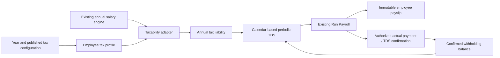

# Indian income tax / TDS: investigation and proposed design

Research date: 30 October 2026. Status: investigation and design only. No tax feature, rates, collections or payroll behavior have been implemented by this document. The implementation workflow document requested as `INDIAN-INCOME-TAX-TDS-ENGINE.md` will describe the actual delivered system after implementation.

## Available inputs and confirmed scope

The complete pasted task was read. The separately referenced **Excelhire – India Payroll TDS Engine: Functional Requirements & Development Plan – Version 1.0** was not found among available attachments; there is no connected Word document session. Its initial functional scope and illustrative examples have therefore not been reviewed. It is required before implementation under the task's explicit instructions.

The user confirmed resident salaried employees with salary-only income as the bounded first release, and explicitly authorized a payment/TDS confirmation workflow. Selection of starter tax years was delegated to research. Proposed initial coverage is FY 2025–26 and Tax Year 2026–27, covering the two tax years encountered by the application's current calendar-year payroll selector. Future years remain administrator-configurable without copying one year's rates automatically.

## Existing application boundaries

- `src/payroll-generator/salary-calculation.service.ts` exposes `calculateAnnual`, backed by the existing exact-rational annual engine. `PayrollCalculationModule` exports that provider. The engine's outputs include `annualGrossWages`, `annualTotalDeductions`, `annualNetPay`, employer contributions and individual annual/monthly component amounts.
- The existing engine verifies Gross against CTC less employer EPS/EPF/ESI. Its reported Net Pay subtracts the existing reported employee deductions from reported Gross. TDS must consume these outputs; it must never solve or replace those equations, or independently sum earnings/allowances to invent Gross.
- `src/run-payroll/run-payroll.service.ts` derives monthly values, snapshots calculation inputs and hashes, saves versioned drafts, and finalizes embedded payslips atomically in the existing payroll-period aggregate. Submitted checks and PDF bytes are immutable. Submission means **Payment Pending**, not confirmed payment.
- `BusinessModelsModule` and trusted `tenantContext` select organization-scoped models. New feature models must follow that mechanism. Global `AuthGuard` already enforces sessions, CSRF origin/header checks and Super Admin separation. It does not automatically restrict arbitrary new settings controllers to organization administrators; explicit tax authorization is required.
- The employee model contains date of birth and employment history, but no tax residency, PAN-operability status, tax regime, prior TDS, declarations or tax-year profile. These facts cannot be guessed from salary or nationality.
- Angular Settings currently owns salary components and links to statutory settings. Run Payroll has its own lazy-loaded feature area; Employee Profile has reusable sections and Pay Checks. New tax screens should follow those boundaries.

## Official-source research register

This register records evidence already inspected, not a claim that research or production legal validation is finished. Bills, older FAQs and proposed amendments must not silently replace enacted rules.

| Source | Use and evidence |
| --- | --- |
| [Income-tax Act, 2025, amended by Finance Act, 2026](https://www.incometaxindia.gov.in/documents/d/guest/income_tax_act_2025_as_amended_by_fa_act_2026-pdf) | Sections 19, 156, 202, 392 and 516 checked in the official consolidated text. |
| [Department transition/TDS guidance](https://www.incometax.gov.in/iec/foportal/help/all-topics/e-filing-services/tds-compliance?mobile-app=1) | Payment-date transition and new salary-withholding provision. |
| [Department tax-payment guidance](https://www.incometax.gov.in/iec/foportal/help/all-topics/e-filing-services/tax-payments-faq?mobile-app=1) | FY 2025–26 maps to AY 2026–27; income from FY 2026–27 uses Tax Year 2026–27. |
| [Department individual computation guide](https://wm.incometaxindia.gov.in/w/computation-of-tax-for-individual-1) | Historical-year distinctions, age/residency conditions, rebate and surcharge overview. Indexed official content was available; direct retrieval was intermittently denied. |
| [Department deductions reference](https://wm.incometaxindia.gov.in/w/deductions-allowable-to-tax-payer) | Regime-dependent deduction eligibility; payroll deductions do not automatically become income-tax deductions. |
| [Department PAN/TDS guidance](https://wmstatic-prd.incometaxindia.gov.in/web/guest/w/what-are-the-payments-covered-under-the-tds-mechanism-and-the-rates-for-deduction-of-tax-at-source-) | PAN conditions require separate handling; missing identity facts cannot receive a normal-rate calculation silently. |
| [Finance Act, 2026 gazette](https://egazette.gov.in/WriteReadData/2026/271439.pdf) | Enacted annual rate/surcharge/cess reference to finish checking before activating starter configurations; retrieval timed out in this investigation. The Finance Bill was located but is not treated as a substitute. |

Verified statutory anchors from the consolidated 2025 Act: effective 1 April 2026; standard deduction up to salary, capped at Rs 75,000 new / Rs 50,000 otherwise (s19); resident rebate Rs 12,500 through Rs 5 lakh, or new-regime Rs 60,000 through Rs 12 lakh with marginal relief (s156). New slabs: 0/5/10/15/20/25/30%, with boundaries Rs 4/8/12/16/20/24 lakh (s202). Salary withholding uses estimated annual income at payment (s392). Total income and payable/refundable amounts use the statutory nearest-Rs-10 rule after ignoring paise (s516). These are research facts, not installed constants.

For FY 2025–26, use the then-applicable 1961 Act provisions, including 16(ia), 87A, 115BAC, 192 and 288A/288B. The Department's AY 2026–27 material cannot simply be relabelled as a new financial year's rules. Older portal FAQs still mentioning Rs 50,000 for both regimes are not a current universal rule. The transition guidance also makes an expected payroll date insufficient evidence of actual withholding.

Remaining research before starter activation: enacted annual Finance Act schedules for each initial year; surcharge tiers and relief at every threshold; cess sequence; old-regime age bands; the corresponding PAN provisions and applicable exceptions; permitted declarations, deductions and relief within the agreed salary-only scope; payment-date/year-boundary cases; and amendments/notifications subsequent to the consolidated source's stated amendment level. No uncertain value will be installed as statutory data.

## Minimum extension for taxability

Keep salary-component definitions and their earning/deduction categories unchanged. Add a separate, versioned mapping keyed by organization, tax year, regime and component ID. It records tax treatment, approved calculation rule, legal reference, eligibility/evidence requirements, effective interval and reviewer. Fully exempt, partially exempt and conditional entries need their legal conditions; a percentage alone cannot establish eligibility.

The salary adapter starts with the existing annual Gross and adds only explicitly supported tax adjustments. It must prevent double-counting components already represented in Gross. Neither employer contributions nor all payroll deductions are automatically added/subtracted for tax. Unmapped or unsupported tax-sensitive facts must produce a review/blocking status for TDS-enabled processing rather than a fabricated exemption or zero tax.

## Proposed backend and persistence design

`tax-configuration/` owns year metadata, regime-specific master revisions, slab sets, taxability mappings, activation validation and audit. `income-tax/` owns a pure annual-tax engine, an adapter consuming existing annual salary results, projection snapshots, paycheck allocation and confirmed withholding. Run Payroll consumes the resulting deduction through an injected interface. Neither tax module depends on Run Payroll; historical data access uses a narrow read interface without a circular module dependency.

Proposed organization-scoped persistence:

- `tax_configuration_registry`: a versioned registry/control record for year intervals, the active processing context and published revision pointers. Serialize activation/interval changes so concurrent requests cannot create overlapping years or two active contexts.
- `tax_configuration_revisions`: immutable published configuration revisions containing independent master parameters and slab sets, applicability conditions, rounding/rule versions, reviewed sources and actor/timestamps. Separate logical master/slab editing can publish one validated revision atomically. Draft edits do not alter a published revision.
- `salary_component_taxability`: independently versioned tax treatment mappings; never mutate salary formulas.
- `employee_tax_profiles`: organization + employee + year uniqueness, with versioned regime, applicability/reason, residency, required identity facts, projection dates and calendar references. Preserve previous profile versions.
- `employee_tds_calculations`: append-only estimates referencing exact salary/configuration/profile/mapping versions and input hashes. These estimates are not payroll posting records.
- Finalized payroll checks remain the authority for submitted TDS allocations: add optional tax breakdown/version fields inside new checks. Do not create a second finalized ledger that requires an unsafe, separate write after the existing atomic payroll submission.
- `tax_withholding_confirmations`: append-only, idempotent authorized confirmations referencing submitted employee-period checks, actual payment/deduction date and actor. Protect uniqueness against duplicate confirmation. Government remittance is a distinct future compliance event; payment confirmation does not claim a challan was deposited.

All indexes use trusted organization scope. Referenced years/revisions cannot be deleted; published corrections create new revisions. Updates use optimistic versions. Detailed tax/profile operations require an explicit role policy, with organization administrators permitted to configure/confirm and Super Admin denied customer tax data. Logs must not expose salary/PAN/declaration values.

## Calculation and payroll integration contract

1. Resolve actual applicable year/regime/rule revision and complete employee facts; return explicit incomplete/unsupported status where necessary.
2. Reuse the existing annual salary result. Apply approved taxability adjustments, eligible deductions and standard deduction; clamp taxable income to zero. Apply the applicable taxable-income rounding rule at its defined step.
3. Compute progressive slab tax, eligible rebate and its marginal relief, surcharge and its separate marginal relief, cess, then statutory final-liability rounding. Keep the existing `Ratio` precision approach; no binary floating-point accumulation or intermediate display rounding.
4. Return annual liability, confirmed tax already withheld, remaining liability, reserved-but-unpaid allocations, remaining paychecks, periodic TDS, full breakdown and all version references. Do not label reserved allocations as tax already deducted.
5. For an unchanged full-year monthly schedule, distribute annual liability across the configured 12 checks. Use exact minor-unit allocation with a deterministic residual adjustment so the check amounts reconcile exactly. For revised projections, use confirmed withholding and the actual remaining calendar; do not keep dividing by 12 after missing checks or mid-year joining.
6. A joiner's annual earnings projection needs an explicit payroll-calendar/employment policy, not an assumption that Annual CTC was earned for all twelve months. Unsupported prior-employer income or claims remain visible as exclusions and block any assertion of comprehensive liability.
7. Wrap existing monthly outputs: `deductionsAfterTds = existingMonthlyDeductions + periodicTds`; `netAfterTds = existingMonthlyNet - periodicTds`. Gross, CTC, employer amounts, old deduction cells and their rounding stay unchanged. Preserve the pre-tax outputs separately. Do not silently clamp an unaffordable deduction to zero net; show an allocation exception.
8. Include tax inputs/configuration/profile/calendar/balance versions in TDS-enabled draft freshness checks. Recalculation is pure; draft saving does not confirm or post tax. Finalize one TDS component and its explanation with the existing atomic check/PDF submission.
9. Submitted PDFs/snapshots never change. Configuration changes invalidate only appropriate unsubmitted estimates. Repeated submit/confirm calls must return the original result without another deduction.

Cross-period allocation concurrency needs an explicit guard: the existing period aggregate serializes requests within a month, but cannot alone serialize annual TDS adjustments across different months. The implementation must validate reservation/balance versions and test concurrent employee-year allocation before enabling catch-up processing. It must retain existing standalone-Mongo support rather than assume multi-document transactions.

The newly authorized confirmation action must distinguish expected payment date from actual payment/deduction date. A date falling outside the snapshot's applicable tax year requires a visible correction/review workflow; it cannot silently mutate the original payslip or count withholding in the wrong year. Migration/opening-balance handling must be explicit when enabling TDS after earlier payrolls have already been submitted.

## Proposed UI and APIs

Settings gets a dedicated Tax Configuration area with year selection, independently editable Old/New masters, slabs, mappings, validation, immutable revision history and activation confirmation. Employee Profile gets Income Tax Details and an estimated TDS summary. Run Payroll gets a separate TDS cell/breakdown and the existing deduction/net totals include it. Authorized payment/TDS confirmation remains distinct from Submit.

Proposed API groups, not existing endpoints:

- `/settings/tax-configuration/years`, `/revisions`, `/validate`, `/activate`: administrator-only configuration lifecycle.
- `/employees/:id/tax-profiles/:year`: authorized per-year profile retrieval/update with version checks.
- `/employees/:id/tds-projections`: authorized projection generation/history; no posting side effect.
- `/payroll/runs/:period/checks/:id/withholding-confirmation`: administrator-only actual payment/TDS confirmation, idempotency key and immutable submission reference.

## Implementation and validation sequence

1. Obtain/read the missing Version 1.0 document, reconcile its initial scope and finish the legal source matrix. No illustrative tax values become defaults merely because they appear in that document.
2. Implement tax configuration/revision validation, administrator authorization, tenant isolation and independent component mappings. No automatic historical tax activation.
3. Implement the pure annual engine and exact allocation with official worked fixtures, every slab/rebate/surcharge boundary, rounding, age/residency eligibility, zero liability and unsupported facts.
4. Add per-year employee profiles/projections and the authorized payment confirmation path. Cover opening balances, paid versus reserved amounts, year-crossing dates and mid-year calendars.
5. Add opt-in Run Payroll integration, fingerprints and immutable TDS snapshots/PDF rows. Verify no change for existing payroll without TDS, no duplicate allocation, stale drafts, concurrent months and retry behavior.
6. Deliver Angular forms, summaries and breakdowns, then the actual workflow/API/database documentation and production builds, complete unit/regression/Mongo/browser checks. Report existing baseline failures separately; do not alter old formula tests to conceal them.

Existing local modifications remain outside this work: backend account-storage, organization and startup-lock tests; frontend delete-confirmation. No application source, configuration, collections, commits or pushes changed during this investigation. No tests/builds were rerun for this documentation-only phase, and no implementation test results are claimed.
