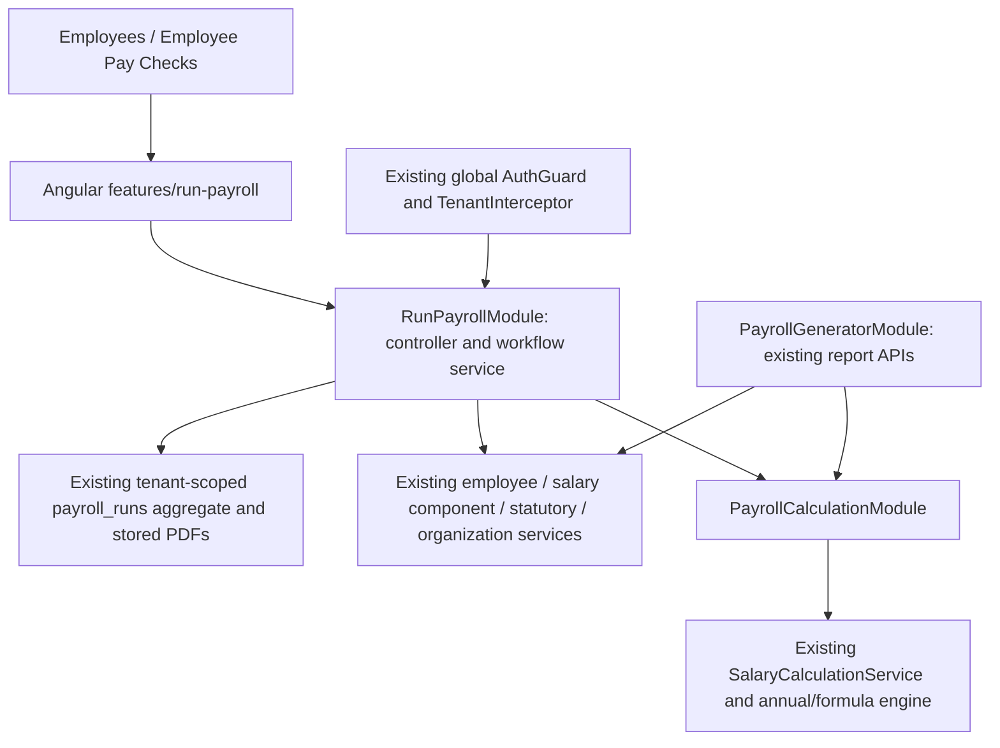

# Run Payroll architecture refactor

## Investigation and dependency map (before changes)

Backend Run Payroll currently lives in `src/payroll-generator/payroll-run.*`, with its own module/controller/service/schema and tests. `payslip.ts` is used exclusively by this workflow. The service owns period/date/eligibility validation, previews and selections, immutable calculation snapshots, draft CAS updates, submission/idempotency/duplicate prevention, history and PDF orchestration. Both PayrollRunModule and PayrollGeneratorModule separately register SalaryCalculationService.

Payroll Generator's controller/service provide the existing annual calculation/report APIs. SalaryCalculationService delegates to annual-payroll/formula/decimal utilities and owns the existing salary calculation interface. SalaryComponentsModule and StatutoryDeductionsModule provide organization-scoped configuration. Neither calculation service depends on Run Payroll.

Run Payroll also consumes Employee models, organization configuration, tenantContext and BusinessModelsModule. PayrollRun model token maps to the existing `payroll_runs` collection (tenant prefixes through BusinessModelsModule). The schema embeds finalized checks/PDFs and uses organization+period uniqueness, optimistic versions and atomic predicates. AuthModule installs the global AuthGuard and TenantInterceptor; no feature-local guard replaces them. Run Payroll routes are under `/payroll/runs` and `/payroll/employees/:id/checks`; the existing generator owns `/payroll/annual`.

Frontend Run Payroll page/client/guide/tests are mixed into `src/app/payroll` alongside the distinct PayrollGenerator dialog and annual/monthly report services. The Run Payroll page uses EmployeeService, Organization, shared icons/navigation context, Angular forms and the payrollMonths calendar helper. Employee Pay Checks consumes its history/PDF client. EmployeeList links to `/payroll/run`; EmployeeProfile uses validated origin state. App routes supply existing authentication guards. Shared NavigationContext holds UI origin and bounded memory only, with type-only references to payroll response models.

Planned boundary: Run Payroll owns workflow orchestration, schema, DTOs, PDFs, page and client. Payroll Generator retains its APIs/reports and all calculation logic, exposing the existing calculator through a controller-free PayrollCalculationModule. Shared employee/configuration/auth/tenant/navigation services are consumed without duplication. Existing paths and data contracts remain compatible. No database migration is required.

## Implemented architecture



The Run Payroll module imports the controller-free calculation module rather than the Generator feature module. Generator does not import Run Payroll. Nest shares the calculator provider across both consumers. The calculation engine and decimal utilities remain in Payroll Generator: their responsibilities did not change and moving them would add unnecessary churn. No formula was copied or rewritten.

Backend layout:

```text
src/run-payroll/
  run-payroll.module.ts
  run-payroll.controller.ts
  run-payroll.service.ts
  run-payroll.dto.ts
  schemas/payroll-run.schema.ts
  payslip.ts
  run-payroll.module.spec.ts
  run-payroll.controller.spec.ts
  run-payroll.integration.spec.ts
  payslip.spec.ts
src/payroll-generator/
  payroll-calculation.module.ts       # exports existing SalaryCalculationService
  payroll-generator.module.ts         # imports that calculation module
  payroll-generator.controller.ts     # unchanged report behavior
  payroll-generator.service.ts       # unchanged report behavior
  salary-calculation.service.ts      # unchanged calculation interface
  annual-payroll.ts / formula utilities / decimal-ratio.ts
```

Run Payroll owns period/date validation, employee eligibility and selection, preview, KPI projection, draft lifecycle, immutable submission snapshots, duplicate/idempotency checks, history and payslip orchestration. Its request interfaces now live in `run-payroll.dto.ts`; existing service-level runtime validation is preserved. PDF rendering is feature-owned because no other feature uses this renderer. Schema registration retains the exact `PayrollRun` model token.

Frontend layout (standalone Angular conventions):

```text
src/app/features/run-payroll/
  run-payroll.routes.ts
  run-payroll.component.ts / .html / .css
  run-payroll.service.ts
  models/payroll-run.ts
  components/payroll-guide.ts
  run-payroll.spec.ts
  payroll-selection.spec.ts
  unified-payroll.spec.ts
src/app/shared/payroll-calendar.ts
src/app/payroll/                     # existing Generator dialog and report code
```

`app.config.ts` lazy-loads the dedicated feature routes under `payroll`. The page's existing preview/confirmation behavior is retained as one component to avoid changing workflow state during this refactor. The existing guide remains a child component; inputs/table/KPIs retain their present templates rather than introducing unnecessary event/state interfaces. Models are separate from the HTTP client; the client re-exports their types for existing consumers. Shared navigation imports the model file through a type-only import, so authentication and navigation do not load the workflow page. `payrollMonths` moved unchanged to a shared calendar helper; the existing Generator calculation file re-exports it for compatibility. No Generator frontend calculation/report code is imported by Run Payroll.

## Move and change inventory

Backend moves, all from `src/payroll-generator/`:

| Previous file | New file under `src/run-payroll/` |
| --- | --- |
| payroll-run.module.ts | run-payroll.module.ts |
| payroll-run.controller.ts | run-payroll.controller.ts |
| payroll-run.service.ts | run-payroll.service.ts |
| payroll-run.schema.ts | schemas/payroll-run.schema.ts |
| payroll-run.controller.spec.ts | run-payroll.controller.spec.ts |
| payroll-run.integration.spec.ts | run-payroll.integration.spec.ts |
| payslip.ts / payslip.spec.ts | same basenames |

Classes now use `RunPayrollModule`, `RunPayrollController` and `RunPayrollService`; persisted `PayrollRun` names are unchanged. Created the DTO file, controller-free calculation module, and module boundary test. Updated AppModule's import and Generator's provider wiring. Old source copies were removed after relocation; no behavior was removed.

Frontend moves, all from `src/app/payroll/` to `src/app/features/run-payroll/`:

- `run-payroll.ts`, `.html`, `.css` become `run-payroll.component.ts`, `.html`, `.css`.
- `run-payroll.service.ts`, `run-payroll.spec.ts`, `payroll-selection.spec.ts`, `unified-payroll.spec.ts` retain their basenames.
- `payroll-guide.ts` becomes `components/payroll-guide.ts`.
- Created `run-payroll.routes.ts`, extracted `models/payroll-run.ts`, and created `shared/payroll-calendar.ts`.
- Updated `app.config.ts`, Employee Pay Checks and profile test imports, shared navigation's model import and the Generator calendar re-export. Existing browser assertions were retained without changes.

## Compatibility and preserved behavior

All API routes, response shapes, HTTP status behavior, request validation and PDF filenames remain stable. `/payroll/run` and `/payroll/submitted/:period` still support existing links/bookmarks, parameters and browser history state. Existing workspace authentication guards are inherited through the lazy-loaded routes. Global backend authentication, role authorization and organization context enforcement remain unchanged.

Collections, tenant prefixes, indexes, version predicates, embedded draft/submission records, stored PDFs and employee references are unchanged. There is no data migration/reset or new duplicate collection. The existing Mongo integration suite tests atomic submission, idempotent retries, duplicate prevention, organization isolation, original PDF persistence and concurrent updates through the relocated module.

Monthly CTC, employee-level rounding, all four KPIs, historical exclusion, selection/date/period changes, refresh, save/reopen, submission confirmation, paid/submitted presentation, Pay Checks, downloads and navigation-origin preservation retain their existing implementation. Annual/monthly Generator reports continue using their existing APIs and calculations. Unrelated customer onboarding, platform, employee lifecycle, settings, auth and branding implementations were not refactored.

## Executed validation

Before changes: backend and frontend production builds passed; frontend 106 tests across 24 files passed; backend with `RUN_PAYROLL_MONGO_TESTS=1` had 254 passed, 14 skipped and 4 failed.

After changes:

- Both production builds passed. Frontend retains existing initial-bundle/CommonJS warnings.
- Frontend full unit suite: 106 passed across 24 files.
- Backend full suite before adding boundary tests: 254 passed, 14 skipped and the same 4 failures.
- New DI boundary tests: 2 passed. They boot Run Payroll without the Generator/report endpoint and verify both features share one calculator when composed together. The first attempt exposed incomplete test doubles for configuration initialization and connection teardown; those doubles were corrected, without changing production behavior.
- Final backend full suite with Mongo enabled: **256 passed, 14 skipped, 4 existing failures** across 41 suites (33 passed, 7 skipped, 1 failed). The two additional passing tests are the module boundary checks.
- Playwright: 13 passed across `final-ui`, `run-payroll`, `profile-payroll-ui`, `unified-payroll`, `annual-payroll-pdf`, `monthly-payroll-pdf` and `pdf-presentation`. This covers existing Generator PDFs as well as Run Payroll state, submissions, profile refresh/back navigation and historical PDFs.
- Type-aware lint of the relocated backend feature and changed module files passed. Both repositories' `git diff --check` passed.
- Relative runtime-import graph scan: 67 backend and 40 frontend non-test TypeScript source files, zero cycles (including dynamic route imports). Production builds also resolved all relocated imports.

The four baseline failures are unchanged tests in `src/salary-components/salary-calculation.service.spec.ts` with a mandatory BASIC/DA/RA configuration-fixture mismatch. The calculation engine and those assertions were not changed. Tests requiring other opt-in/live infrastructure remain skipped; browser business APIs are mocked, while payroll persistence tests use disposable real Mongo databases. An accidental direct Jest invocation failed because this repository requires its ESM-aware `npm test` script; the proper command was used for reported test results.

## Remaining architectural limits and safety

The workflow service still coordinates a substantial transactional aggregate; it was moved intact to protect concurrency and persistence semantics rather than split aggressively. The preview and confirmation page remain one component, as before. Shared origin state deliberately remains in the account-scoped navigation service because Employees/Profile and Run Payroll both consume it. The calculator's public interface and implementation remain under Payroll Generator behind an independent, persistence-free Nest module.

Existing Monthly-only support, payment-confirmation limitations and embedded immutable PDF storage limits are unchanged. Independent module means a clean DI/maintenance boundary, not a separate deployment: database connection and global authentication/tenant infrastructure are still provided by the application.

No dependencies were added. Existing modified/untracked work was preserved; no commits, pushes, branch changes, destructive Git operations or database resets were performed. Disposable integration databases were cleaned up by their existing tests.
